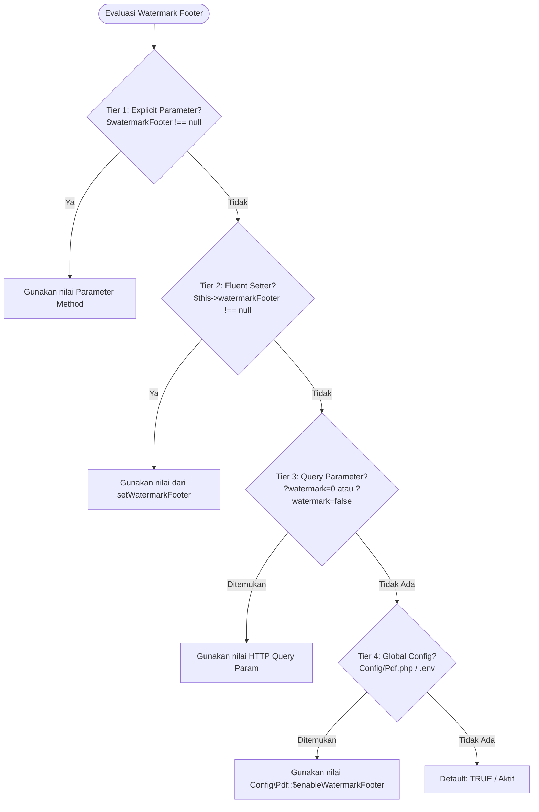

# Arsitektur & Dokumentasi Watermark Footer PDF (mPDF)

Dokumentasi ini merangkum arsitektur, implementasi teknis, hierarki konfigurasi, dan panduan penggunaan fitur **Watermark Footer Terpusat** pada generator PDF SIGAPP menggunakan pustaka `App\Libraries\Mpdf_lib`.

---

## 1. Ringkasan & Tujuan Fitur

Fitur **Watermark Footer** menyediakan footer audit otomatis pada setiap dokumen PDF yang dihasilkan oleh aplikasi SIGAPP. Footer ini berfungsi sebagai penanda keabsahan cetakan fisik maupun digital dengan mencatat identitas aplikasi, timestamp pencetakan (WIB), identitas pengguna yang mencetak, dan penomoran halaman.

### Komponen Utama
1. **`App\Libraries\Mpdf_lib`**: Pustaka pembungkus (wrapper) mPDF terpusat yang mengatur formatting, chunking HTML, auto-guard margin, dan injeksi watermark footer.
2. **`Config\Pdf`**: File konfigurasi terpusat di `app/Config/Pdf.php` untuk mengatur perilaku default pencetakan PDF di seluruh aplikasi SIGAPP.

---

## 2. Format & Spesifikasi Tampilan Footer

Watermark footer dirancang minimalis dan rapi agar tidak mengganggu layout dokumen utama:

- **Border Atas**: `0.5px solid #dcdcdc` (garis pemisah halus).
- **Tipografi**: Font sans-serif, ukuran `6.5pt`, warna `#777777` (abu-abu netral).
- **Struktur Layout**: Tabel 1 baris dengan 2 kolom:
  - **Kolom Kiri (70%)**:
    ```text
    Dokumen ini dicetak otomatis melalui {appName} pada {DD/MM/YYYY HH:mm} WIB oleh {username}
    ```
    *(Catatan: Bagian `oleh {username}` otomatis diisi dari session pengguna aktif via Myth/Auth `user()->username` jika pengguna sedang login).*
  - **Kolom Kanan (30%, rata kanan)**:
    ```text
    Hal. {PAGENO}
    ```
    *(Menggunakan tag makro bawaan mPDF untuk nomor halaman saat ini).*

---

## 3. Hierarki Kontrol Toggle (4-Tier Hierarchy)

Pustaka `Mpdf_lib` mengadopsi mekanisme evaluasi bertingkat (cascade resolution) untuk menentukan apakah watermark footer harus dicetak atau dinonaktifkan. Tingkatan dievaluasi dari prioritas tertinggi ke terendah:



### Rincian 4 Tingkatan:

1. **Tier 1: Argument Method (Prioritas Tertinggi)**
   - Parameter langsung pada method `generate()` atau `renderBinary()`:
     ```php
     $mpdfLib->generate($html, 'dokumen.pdf', '', [15, 15, 25, 45], 'A4', true, '', false);
     // atau via named arguments:
     $mpdfLib->renderBinary($html, watermarkFooter: false);
     ```

2. **Tier 2: Fluent Setter Method**
   - Mengatur instance secara eksplisit melalui chained call:
     ```php
     $mpdfLib->setWatermarkFooter(false)->renderBinary($html);
     ```

3. **Tier 3: HTTP Request Query Parameter**
   - Mendeteksi parameter GET URL `?watermark=0` atau `?watermark=false` melalui `service('request')->getGet('watermark')`.
   - Sangat berguna untuk pengujian visual, bypass saat print preview khusus, atau kebutuhan integrasi tanpa mengubah kode.

4. **Tier 4: Konfigurasi Global & Environment (Config / .env)**
   - Mengambil nilai default dari `app/Config/Pdf.php`:
     ```php
     public bool $enableWatermarkFooter = true;
     ```
   - Dapat di-override melalui file environment `.env`:
     ```ini
     pdf.enableWatermarkFooter = false
     ```
   - Jika konfigurasi tidak didefinisikan, default sistem adalah `true`.

---

## 4. Penanganan Khusus Dokumen & Auto-Guard

Implementasi `Mpdf_lib` menangani berbagai variasi dokumen yang ada di modul-modul SIGAPP:

### 1. Auto-Guard Margin Bawah (Bottom Margin)
Untuk mencegah watermark footer terpotong atau tumpang-tindih pada dokumen yang memiliki margin bawah sangat tipis (misal: label atau surat padat):
- Jika watermark footer **aktif** dan nilai margin bawah (`$mg[3]`) bernilai **kurang dari 8mm**, sistem secara otomatis menaikkan margin bawah ke minimal **8mm**:
  ```php
  if ($isWatermark && isset($mg[3]) && $mg[3] < 8) {
      $mg[3] = 8;
  }
  ```

### 2. Dokumen dengan Tag `<htmlpagefooter>` (Contoh: Kuitansi)
Beberapa dokumen seperti Kuitansi mendefinisikan footer khusus menggunakan tag bawaan mPDF (`<htmlpagefooter name="...">`).
- `Mpdf_lib` mendeteksi keberadaan tag `</htmlpagefooter>` via regex.
- Jika terdeteksi dan watermark aktif, HTML watermark disisipkan secara mulus tepat sebelum tag penutup `</htmlpagefooter>`, sehingga layout kuitansi dan footer watermark tetap menyatu tanpa merusak pagination mPDF.

### 3. Dokumen Berupa Array Halaman (Contoh: SPPTB Multi-Page)
Untuk dokumen yang di-pass berupa array halaman (`is_array($html)`):
- Halaman array bertipe asosiatif (`['html' => '...', 'footer' => '...']`): footer bawaan halaman digabungkan dengan watermark.
- Halaman array biasa: halaman pertama menggabungkan custom footer + watermark, dan halaman berikutnya tetap menyertakan watermark footer dengan penomoran halaman dinamis `{PAGENO}`.

### 4. Proteksi PCRE Backtrack Limit (Chunked Rendering)
Fungsi `writeHtmlChunked()` memisahkan blok `<style>` ke mode `HEADER_CSS` dan memotong body HTML dalam blok per 500 KB pada batas tag HTML yang valid (`>`) agar terhindar dari batas `pcre.backtrack_limit` pada dokumen besar/kompleks.

---

## 5. File Konfigurasi: `app/Config/Pdf.php`

```php
<?php

namespace Config;

use CodeIgniter\Config\BaseConfig;

class Pdf extends BaseConfig
{
    /**
     * Mengaktifkan atau menonaktifkan watermark footer secara global.
     */
    public bool $enableWatermarkFooter = true;

    /**
     * Nama aplikasi yang dicantumkan pada teks footer.
     */
    public string $appName = 'SIGAPP';

    /**
     * Menyertakan nama user aktif (' oleh {username}') jika login.
     */
    public bool $includeUsername = true;

    /**
     * Menyertakan nomor halaman (' Hal. {PAGENO}').
     */
    public bool $includePageNumbers = true;
}
```

---

## 6. Contoh Panduan Penggunaan Developer

### Contoh 1: Cetak Standar (Watermark Footer Otomatis Aktif)
```php
$mpdfLib = new \App\Libraries\Mpdf_lib();
$html = view('modul/cetak_laporan', $data);

// Otomatis menampilkan watermark footer default
$mpdfLib->generate($html, 'Laporan-Keuangan.pdf');
```

### Contoh 2: Mematikan Footer untuk Dokumen Khusus (Sertifikat / Blangko Resmi)
```php
$mpdfLib = new \App\Libraries\Mpdf_lib();
$html = view('legal/cetak_sertifikat', $data);

// Matikan via argument method
$mpdfLib->generate($html, 'Sertifikat.pdf', '', [10, 10, 10, 10], 'A4', true, '', false);

// Atau via fluent setter
$pdfBinary = (new \App\Libraries\Mpdf_lib())
    ->setWatermarkFooter(false)
    ->renderBinary($html);
```

### Contoh 3: Bypass Melalui URL Parameter untuk Debugging
Pengguna atau QA dapat menambahkan parameter `?watermark=0` pada URL controller cetak untuk melihat hasil render dokumen bersih tanpa watermark tanpa perlu mengubah baris kode apapun.

---

## 7. Status Pengujian & Jaminan Mutu (QA)

| Item | Status | Keterangan |
|---|---|---|
| **Sertifikat QA** | **PASS** | `QA-SIGAPP-MPDF-20261103-01` |
| **Unit Test Suite** | **PASS** | `tests/unit/MpdfLibWatermarkFooterTest.php` |
| **Jumlah Tes** | 4 Tests | `testWatermarkFooterEnabledByDefault`<br/>`testWatermarkFooterDisabledViaParam`<br/>`testWatermarkFooterMergingWithCustomFooter`<br/>`testWatermarkFooterMultiPageArray` |
| **Jumlah Assertion** | 14 Assertions | 100% Passed tanpa error/warning |
| **Integritas Kode** | **Terverifikasi** | Tidak ada modifikasi yang merusak fungsionalitas existing (backward compatible). |
